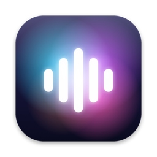
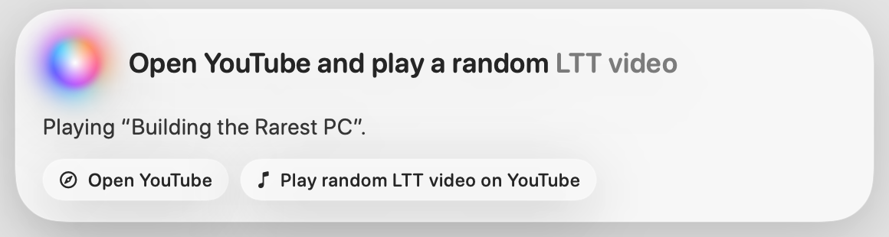
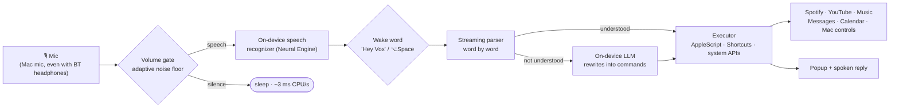

<div align="center">



# Vox

**Hands-free voice control for macOS. On-device, instant, and it finishes what you ask.**

[-2f6feb?style=for-the-badge&logo=apple)](../../releases/latest)


<br>

<picture>
  <source media="(prefers-color-scheme: dark)" srcset="docs/hud-dark.png">
  
</picture>

*Say **"Hey Vox, open YouTube and play a random LTT video"**. The popup shows what it heard,
what it's doing, and each action as it runs.*

</div>

---

Say **"Hey Vox"** or hold **⌥Space** and talk. Commands start **while you're still speaking**, and Vox goes back
to sleep after each one. Speech recognition and the language model run on-device, so nothing you say leaves the Mac.

## Download

| | |
|---|---|
| **Vox 1.2 for macOS** | [`Vox-1.2.dmg`](../../releases/latest) from the Releases page |
| **Requires** | macOS 26 or later on Apple silicon (built and used daily on macOS 27, MacBook Air) |
| **Not available for** | Windows or Linux. Vox is built on macOS-only frameworks: Speech, AppleScript, Accessibility and Apple's on-device Foundation model |

1. Open the DMG and drag **Vox** to **Applications**.
2. The app is ad-hoc signed, not notarized, so the first time **right-click → Open** (or *System Settings → Privacy & Security → Open Anyway*).
3. Allow **Microphone**, **Speech Recognition** and **Accessibility** when asked, and allow Vox to control each app it drives (Spotify, Safari, Messages …).

## See it think

Vox parses speech **word by word**, so the first command fires before you finish the sentence. This is real output from the
simulator that the test suite uses (`Vox --simulate`):

```text
$ Vox --simulate "open safari and youtube and play a random LTT video"
   heard "open safari"  →  Open Safari
   heard "open safari and youtube and play"  →  Open Youtube
   final  →  Play a random ltt video on YouTube

$ Vox --simulate "set a timer for 10 minutes and turn the volume to 30"
   heard "set a timer for 10 minutes and turn"  →  Timer 10 minutes
   final  →  Volume 30%

$ Vox --simulate "what's 15 percent of 2400"
   final  →  360

$ Vox --simulate "message mom I'm on my way"
   final  →  [to on-device model] "message mom I'm on my way"

$ Vox --simulate "hey vox open spotify" --wake
   woke at "hey vox"
   final  →  Open Spotify
```

## How it works



## What it does
| Area | Examples |
|---|---|
| Apps & web | open / quit / switch apps, websites, Google/YouTube/Amazon search, tabs, back, scroll, find on page |
| Music & video | play songs (Spotify, Apple Music library, YouTube), play/watch videos ("random", "latest"), pause/next, "what's playing" |
| Typing & text | live dictation, summarize/explain/translate/rewrite/fix grammar for the selection, page or clipboard |
| Messages | iMessage, WhatsApp and email to contacts (always asks before sending) |
| Time & plans | timers, alarms, reminders with dates, calendar agenda, add events, notes |
| Answers | web-grounded answers, weather and rain, exact math, unit and currency conversion, date/time, battery, storage |
| Maps & files | directions, places near me, Spotlight file open, folders, Settings panes |
| Mac | volume/brightness levels, Wi-Fi, dark mode, window tiling, screenshots, lock, Shortcuts, restart/shut down (asks first) |

Anything the rules don't understand is rewritten by the on-device model into these commands.

## Principles
- **Finish the request.** "Play X" plays X; it never stops at a search page. Results are checked:
  Spotify tracks skipped in your region fall back to the next match, YouTube is nudged to play if autoplay is blocked,
  and failures are said out loud. A song Spotify can't find plays on YouTube instead of stopping at a search page.
- **Never launch Apple Music by accident.** Play, pause and next go to the app that's actually playing (Spotify, Music
  or a browser tab), not to the media key, which opens Music when nothing is playing.
- **The model never invents.** Song-title fixes must sound like what was heard; lone fragments aren't rewritten.
- **Ask before anything irreversible**, such as sending a message or shutting down.
- **Don't fire early.** Unfinished clauses ("play a …", "cancel the …") wait, and so does a short command that
  starts a different longer one ("quit…", "stop…", "send…", "play…") when you pause after it, so "quit… Spotify"
  never presses ⌘Q on the app in front. "Yes" never presses keys; "send it" sends.
- **Never hang.** AppleScript runs off the main thread with a hard deadline, keychain reads too. If macOS hasn't
  allowed Vox to control an app (or can't ask, on the lock screen), Vox says how to fix it instead of freezing.
- **Recover by itself.** If the mic or recognizer stops (headphones connect, sleep, an error), hands-free
  restarts, backing off if it keeps failing.
- **Use the right mic.** With Bluetooth headphones as the input, Vox listens with the Mac's mic: a headset mic
  switches the headphones into call mode (muffled music, first words cut off). Settings can turn this off.
- Every command and every fixed bug gets a test: `Tests/commands.txt` (use `--` for a pause mid-sentence),
  `Tests/wake.txt`, `Tests/brain.txt`, `Tests/songs.txt`. `./test.sh` must pass before installing.

## Power (MacBook Air, measured with powermetrics)
- **Waiting for "Hey Vox":** Vox ~3 ms of CPU per second, plus ~0.1 core in coreaudiod, which is the Mac mic's own
  processing and the same for any app that listens. In total, tens of milliwatts. A volume gate (two loud 100 ms
  buffers in a row, adaptive noise floor) feeds the recognizer only while someone speaks, and 0.8 s of silence
  afterwards lets it finish the phrase and stop. ⌥Space only (hands-free off): 0.
- **During a command:** Vox peaks around 13 ms/s of CPU. The popup's orb is drawn by Core Animation (about 1% CPU
  while shown, down from ~5%). Recognition is a few tens of mW on the Neural Engine.
- **The language model is the only big burst** (about 1 s at 5–6 W on the Neural Engine). It runs only for phrasing
  the rules don't understand, questions, and song titles Spotify can't match as heard, never on wake.
- Echo cancellation ("Hear me over music") costs about 20% CPU, so it's off by default.

## Proof: the test suite

Every command and every fixed bug gets a test, and `./test.sh` must pass before `build.sh` installs anything.
The 1.2 release build passes all **118**:

| Suite | File | Cases | What it checks |
|---|---|---:|---|
| Commands | `Tests/commands.txt` | 89 | phrase fed word by word (like live speech) → exact actions, in order |
| Wake word | `Tests/wake.txt` | 19 | strong / weak / no wake for near-miss phrases |
| On-device model | `Tests/brain.txt` | 4 | rewrites of phrasing the rules don't know |
| Song titles | `Tests/songs.txt` | 6 | mis-heard titles corrected to what was meant |

```text
$ ./test.sh
118/118 passed
```

## Build from source

```bash
xcode-select --install          # Swift 6 toolchain
./test.sh                       # 118 regression tests
./build.sh                      # tests, builds, signs and installs to /Applications
./build.sh --dmg                # same, plus dist/Vox.dmg
```

## Known issues

- Saying "next song" while Spotify plays moves to the next track but can leave it paused, and Vox replies "nothing queued". Being fixed.
- Ad-hoc signed: other Macs need right-click → Open the first time. Public distribution needs an Apple Developer ID and notarization.

## Developer test modes
    .build/release/Vox --simulate "open safari and youtube" [--wake]    # parse only, word by word
    .build/release/Vox --brain "put on some arijit"                     # on-device model rewrite / answer
    .build/release/Vox --song "chan marrier"                            # song-title correction
    .build/release/Vox --render-hud /tmp                                # popup design → PNG
    open -n /Applications/Vox.app --args --exec "<command>" /tmp/x.log  # REALLY executes, logs outcomes
    open -n /Applications/Vox.app --args --listen-test 8 /tmp/l.log [--continuous]   # mic → transcript, gate stats
    open -n /Applications/Vox.app --args --hud-test 20                  # live popup, to measure drawing cost
    open -n /Applications/Vox.app --args --permissions /tmp/p.log       # which apps Vox may control
    open --env VOX_LOG=/tmp/vox.log /Applications/Vox.app               # trace wakes, commands and outcomes

---

Made by **Kamalesh VS** · [github.com/kkjjkamal123](https://github.com/kkjjkamal123) · [kkjj.me](https://kkjj.me)
